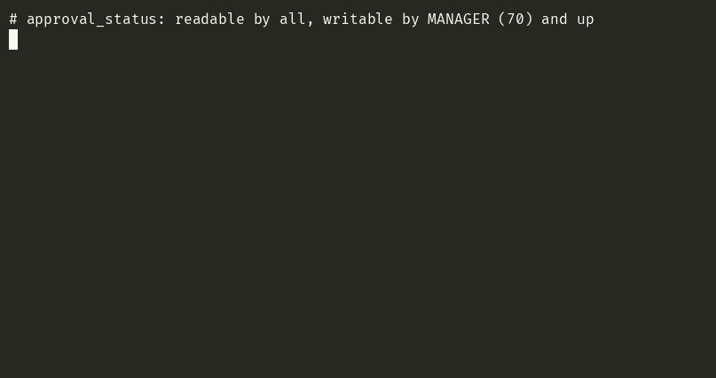

# MantisBT custom-field write-access bypass through group actions

Proof of concept for
[GHSA-5xh9-366r-7965](https://github.com/mantisbt/mantisbt/security/advisories/GHSA-5xh9-366r-7965).
A MantisBT custom field can be readable by everyone but writable only above
a set access level. The bulk group action in `bug_actiongroup.php` wrote
custom fields without checking that level, so any user who could view an
issue could change any custom field on it. Affects MantisBT up to 2.28.4,
fixed in **2.29.0**, commit
[68eb1d3](https://github.com/mantisbt/mantisbt/commit/68eb1d3ba3ce706151982743a37e244b1c8c3e33).



## The bug

The single-issue update in `bug_update.php` calls
`custom_field_has_write_access()` before it writes a custom field. The
`CUSTOM` case in `bug_actiongroup.php` only checks that the user can view
each issue, then calls `custom_field_set_value()`, which does no access
check of its own:

```php
// bug_actiongroup.php, 2.28.4
case 'CUSTOM':
    if( 0 === $f_custom_field_id ) {
        trigger_error( ERROR_GENERIC, ERROR );
    }

    $t_form_var = 'custom_field_' . $f_custom_field_id;
    $t_custom_field_value = gpc_get_custom_field( $t_form_var,
        $t_custom_field_def['type'], null );
    custom_field_set_value( $f_custom_field_id, $t_bug_id,
        $t_custom_field_value );
```

The form page that mints the CSRF token for this action does not check the
field's write level either, so a low-privilege user can fetch a valid token
and post the action.

## Run it

Needs Docker with Compose and Python 3 with `requests`. The first start takes
a few minutes while the container installs PHP extensions and MantisBT.

```bash
./run.sh release-2.28.4   # vulnerable
./run.sh release-2.29.0   # fixed
```

`setup.sh` installs the chosen tag with default settings. `seed.php` then
creates, through MantisBT's own APIs:

- a public project with one issue
- a custom field `approval_status`, readable by VIEWER and writable only by
  MANAGER (70) and up
- a user `reporter1` at REPORTER (25), the level a self-registered account
  gets by default

`exploit.py` logs in as `reporter1`, tries the normal single-issue update
of the field as a control, then sends the `CUSTOM` group action. Set
`MANTIS_URL` to point it at another instance.

```
[1] Log in as reporter1 (REPORTER, 25)
[2] Control: single-issue update of approval_status (write = MANAGER, 70)
    value written: no, refused
[3] Group action CUSTOM on issue 1 with the same field
    value written: yes

[+] VULNERABLE: a REPORTER wrote a MANAGER-only custom field
```

The lab uses PostgreSQL, but the bug does not depend on the database. It
listens on 127.0.0.1 only. Run it against systems you own.

## Fix

Upgrade to MantisBT 2.29.0.

## Disclosure

Reported privately to the MantisBT team in September 2026. The advisory
credits Vishal Shukla and me as finders. The fix
shipped in 2.29.0 on 2026-11-22, when the advisory was published.
